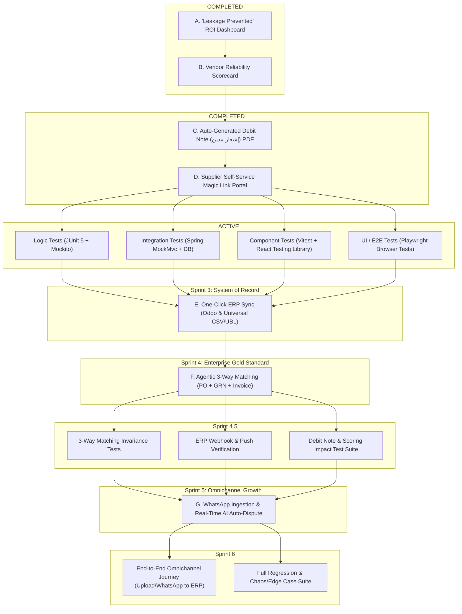

# Commercial Feature Expansion & Agentic AI Implementation Plan

## Goal Description
Transform the existing **Automated Invoice Reconciliation Agent** into an enterprise-ready, high-value commercial B2B platform. This plan details the phased execution order, architecture, testing strategy, and specific **Agentic AI** mechanisms for the commercial features, including multi-tier automated testing (Logic, Component, Integration, UI, and End-to-End) across JUnit 5, Mockito, Vitest, React Testing Library, and Playwright.

---

## Agentic AI Architecture: The Autonomous Financial Auditor

In traditional automation, an application follows rigid script logic. In an **Agentic AI** architecture, the AI acts as an autonomous auditor endowed with **Perception**, **Reasoning**, **Tool Use**, and **Action**:

```
                       ┌──────────────────────────────────────────────┐
                       │           AGENTIC AUDITOR CORE               │
                       │     (Spring AI + Gemini 3.8 Flash)           │
                       └──────┬──────────────┬──────────────┬─────────┘
                              │              │              │
             ┌────────────────┘              │              └───────────────┐
             ▼                               ▼                              ▼
    [Perception Tools]               [Reasoning Engine]              [Action Tools]
┌───────────────────────────┐    ┌────────────────────────┐    ┌───────────────────────────┐
│ • Multimodal Document     │    │ • Semantic SKU mapping │    │ • Generate Debit Note PDF │
│   Ingestion (PDF/Image)   │    │ • Discrepancy analysis │    │ • Trigger ERP Vendor Bill │
│ • Arabic/English Text     │    │ • Behavioral vendor    │    │ • Dispatch WhatsApp/Email │
│   Stripping (PDFBox)      │    │   fraud detection      │    │ • Issue HMAC Magic Token  │
│ • GRN Handwritten Note    │    │ • Deterministic Math   │    │ • Auto-Update DB Status   │
│   Transcription           │    │   Invariance Guard     │    │                           │
└───────────────────────────┘    └────────────────────────┘    └───────────────────────────┘
```

### Core Agentic AI Tenets in this System:
1. **Deterministic Guardrails:** The Agentic AI is empowered to interpret messy, multilingual, real-world supplier documents and counter-arguments, but **must call deterministic Java tools** (`BigDecimal` arithmetic) to verify numbers. The agent *never* calculates totals itself.
2. **Tool-Calling Agent Loop:** In multi-step flows (like 3-Way Matching and WhatsApp conversations), the Agent autonomously decides which tool to invoke next based on intermediate findings.
3. **Contextual Memory & History:** The Agent leverages historical audit patterns (vendor dispute history, accepted tolerances, override history) to guide dispute drafting and risk scoring.

---

## Phased Implementation Roadmap

The roadmap has been structured to include rigorous multi-tier testing gates at each major milestone:



---

## Phase 1: Financial ROI Dashboard & Vendor Scorecard [COMPLETED]

### 1.1 "Leakage Prevented" Hero Metrics
- **Status:** **Implemented** in `FinancialAnalyticsService.java`, `AnalyticsController.java`, and `DashboardClient.tsx`.
- **Features:**
  - Real-time aggregation of Total Invoiced Volume (EGP), Direct Cash Leakage Blocked (price mismatches + unapproved fees), Quantity Shortages, and Clean Invoice Accuracy Rate.
  - Generative Executive Brief synthesized by `gemini-executive-brief.st` providing executive-level savings commentary.
  - Hero KPI display cards on the main dashboard with EGP currency formatting and modal executive brief drawer.

### 1.2 Vendor Reliability Scorecard & Health Badges
- **Status:** **Implemented** in `VendorScorecardService.java`, `VendorController.java`, and `VendorScorecardClient.tsx` (`/vendors`).
- **Features:**
  - Automatic calculation of Clean Match Rate, Total Attempted Overcharges, Discrepancy Breakdown by category.
  - Automated Tier Assignment:
    - 🟢 `CERTIFIED_PARTNER` ($\ge 97\%$ accuracy)
    - 🟡 `AUDIT_SCRUTINY` ($80\% - 97\%$)
    - 🔴 `HIGH_RISK_AUDIT` ($< 80\%$)
  - Dedicated `/vendors` dashboard with search filtering, sortable metrics, and expandable dispute history.

---

## Phase 2: Actionable Dispute Settlement & Supplier Portal [COMPLETED]

### 2.1 Auto-Generated Debit Note (إشعار مدين / خصم) PDF Generator
- **Status:** **Implemented** in `DebitNoteGeneratorService.java`, `InvoiceController.java` (`GET /api/invoices/{id}/debit-note`), and `DisputeActionDrawer.tsx`.
- **Features:**
  - Apache PDFBox dynamic vector rendering of formal corporate Debit Note.
  - Itemized deduction breakdown, PO/Invoice reference headers, tax deduction computation, and net balance calculation.
  - Instant one-click PDF streaming from the Split-Screen auditor drawer.

### 2.2 Supplier Self-Service Dispute Portal (HMAC Magic Link)
- **Status:** **Implemented** in `SupplierPortalController.java`, `HmacTokenService.java`, and `SupplierPortalClient.tsx` (`/portal/dispute`).
- **Features:**
  - Cryptographic HMAC-SHA256 time-bounded tokens for vendor dispute access.
  - Tamper protection (HTTP 403) and expiration protection (HTTP 400).
  - Self-service dispute view: vendor inspects exact price/quantity variances.
  - One-click "Accept Adjustment & Issue Debit Note" (transitions invoice to `RESOLVED_BY_DEBIT_NOTE`).
  - Interactive AI Negotiation Assistant (`gemini-portal-negotiation.st`) evaluating vendor counter-proposals.
  - Amended replacement invoice upload with automated re-reconciliation.

---

## Phase 2.5: Multi-Tier Verification Suite for Phases 1 & 2 [ACTIVE]

To ensure 100% test coverage and production stability, tests are categorized into 5 distinct tiers:

### 1. Logic Tests (JUnit 5 + Mockito + AssertJ)
- **Scope:** Pure business logic and mathematical invariant verification.
- **Suites:**
  - `FinancialAnalyticsServiceTest`: Invariant tests for `totalCashLeakageBlocked`, accuracy formulas, edge cases (0 invoices, all clean, all discrepant).
  - `VendorScorecardServiceTest`: Invariant tests for tier assignment thresholds, total overcharge calculations, category groupings.
  - `DebitNoteGeneratorServiceTest`: Verification of delta deduction math, tax calculations, PDF binary header (`%PDF-`), and PDFBox rendering integrity.
  - `HmacTokenServiceTest`: Token generation, expiration verification, tampering detection, purpose isolation (`PORTAL` vs `OVERRIDE_PAYMENT`).

### 2. Integration Tests (Spring Boot + MockMvc + MySQL)
- **Scope:** REST endpoints, serialization, HTTP status codes, and security filters.
- **Suites:**
  - `AnalyticsControllerTest`: `GET /api/analytics/roi-summary` JSON contract verification.
  - `VendorControllerTest`: `GET /api/vendors/scorecard` and `GET /api/vendors/{vendorName}/scorecard` (200 OK & 404 Not Found).
  - `InvoiceDebitNoteTest`: `GET /api/invoices/{id}/debit-note` returning `application/pdf` binary stream.
  - `SupplierPortalControllerTest`: Full token security lifecycle (`GET /api/portal/dispute`, `POST /api/portal/dispute/accept`, `POST /api/portal/dispute/negotiate`, `POST /api/portal/dispute/upload-amended`).

### 3. Component Tests (Vitest + React Testing Library + @testing-library/jest-dom)
- **Scope:** Isolated frontend UI component rendering, state transitions, event handlers, and accessibility.
- **Suites:**
  - `DashboardRoiMetrics.test.tsx`: Validates rendering of 4 Hero KPI cards, EGP currency formatting, and executive brief toggle modal.
  - `VendorScorecard.test.tsx`: Validates vendor table rendering, tier badge color-coding, and search query filtering.
  - `SupplierPortal.test.tsx`: Validates portal interface with valid token, table of discrepancy items, and "Accept Adjustment" button action.
  - `DisputeActionDrawer.test.tsx`: Validates presence of "Download Debit Note (PDF)" action link and bilingual tab isolation.

### 4. UI Tests & End-to-End Tests (Playwright)
- **Scope:** Full headless/headed browser validation of actual user journeys.
- **Suites:**
  - `roi-dashboard.spec.ts`: End-to-end navigation to dashboard `/`, inspecting metric cards, opening executive brief drawer, status filtering.
  - `vendor-scorecard.spec.ts`: Navigating to `/vendors`, searching for specific supplier, verifying scorecard details and tier badge.
  - `supplier-portal.spec.ts`: Direct link navigation to `/portal/dispute?token=...`, verifying token security guard, inspecting discrepancies, and accepting deduction.
  - `debit-note-download.spec.ts`: Opening invoice split-screen review, opening dispute drawer, clicking "Download Debit Note PDF", and verifying binary download.

---

## Phase 3: Enterprise ERP & Accounting Sync [Sprint 3: System of Record]

### 3.1 One-Click ERP Sync (Odoo API & Universal UBL/CSV)
- **Concept:** Push reconciled, approved invoices and debit notes into enterprise accounting systems (Odoo, SAP, Oracle, QuickBooks) with zero manual data entry.
- **Agentic AI Role:** Schema Mapper mapping vendor line descriptions to internal General Ledger (GL) account codes.
- **Backend:** `OdooSyncService.java` (JSON-RPC on `account.move`), universal CSV/XLSX export endpoint.
- **Frontend:** ERP sync status badges and "Sync to ERP" CTA button.

---

## Phase 4: Agentic 3-Way Matching Engine (PO + GRN + Invoice) [Sprint 4: Enterprise Gold Standard]

### 4.1 Enterprise 3-Way Reconciliation
- **Concept:** Compare Invoice (Billed) $\longleftrightarrow$ Purchase Order (Ordered) $\longleftrightarrow$ Goods Receipt Note (GRN / Delivered).
- **Agentic AI Role:** Multimodal perception of warehouse storekeeper notes, stamped carbon receipts, and damaged delivery vouchers.
- **Backend:** `GoodsReceiptNote` entities, 3-way variance calculation in `ReconciliationEngineService.java`.
- **Frontend:** 3-way toggle viewer in `SplitScreenViewer.tsx`.

---

## Phase 4.5: Intermediate AP Audit & Integration Test Phase [Sprint 4.5]

### Objectives & Test Matrix:
Before advancing to real-time WhatsApp ingestion, validate the complete internal AP automation loop:
1. **3-Way Matching Invariance Tests:**
   - Overbilling vs Delivery: Billed > Delivered (flagged as `QUANTITY_EXCEEDS_DELIVERY`).
   - Price hike vs PO: Invoiced Unit Price > PO Agreed Price.
   - Partial delivery reconciliation: Delivery < Ordered = Billed.
2. **ERP Sync & Push Verification:**
   - Mock Odoo JSON-RPC server verifying `account.move` vendor bill payload structure, GL accounts, and tax lines.
   - Universal CSV/UBL export verification against ISO/UBL schema.
3. **Debit Note & Vendor Scoring Dynamic Impact Tests:**
   - Verify that resolving an invoice via Debit Note adjusts the vendor's scorecard overcharge metric and updates the ROI dashboard prevented leakage tally in real time.

---

## Phase 5: Regional MENA Dominance (WhatsApp Ingestion & Auto-Dispute) [Sprint 5]

### 5.1 Omnichannel WhatsApp Ingestion
- **Concept:** Allow field managers, drivers, and local suppliers to submit invoices simply by sending a photo or PDF over WhatsApp.
- **Agentic AI Role:**
  - Inbound media perception and automated extraction.
  - Real-time conversational dispute negotiation: replies in formatted Arabic with interactive options.
  - Vendor agreement instantly triggers Debit Note creation.
- **Backend:** `WhatsAppWebhookController.java` with Meta Cloud API / Twilio webhook handler and conversational state store.

---

## Phase 6: Full Omnichannel End-to-End System Test Phase [Sprint 6]

### Comprehensive Full-Project Verification Matrix:
The ultimate end-to-end verification covering the entire system lifecycle across all channels:

```
┌────────────────────────────────────────────────────────────────────────────────────────┐
│                         FULL SYSTEM END-TO-END AUDIT PIPELINE                          │
├────────────────────┬──────────────────────────────────┬────────────────────────────────┤
│ Stage              │ Input Channel                    │ Verification Target            │
├────────────────────┼──────────────────────────────────┼────────────────────────────────┤
│ 1. Ingestion       │ Web Upload & WhatsApp Webhook    │ Multimodal Vision (PDF/Images) │
│ 2. Extraction      │ Gemini 3.8 Flash + PDFBox        │ Structured Immutable Records   │
│ 3. 3-Way Match     │ PO + Warehouse GRN + Invoice     │ Pure Java BigDecimal Invariant │
│ 4. Dispute Gen     │ Gemini Bilingual Prompt          │ Strict AR/EN Tab Parity        │
│ 5. Settlement      │ Supplier Portal (HMAC Link)      │ Accept Adjustment & Debit Note │
│ 6. Accounting      │ Odoo JSON-RPC / Universal CSV    │ Vendor Bill Creation in ERP    │
│ 7. Analytics       │ Executive ROI & Vendor Scorecard │ Real-Time Metric Invariance    │
└────────────────────┴──────────────────────────────────┴────────────────────────────────┘
```

- **Testing Tools:** JUnit 5, Mockito, Spring Boot Test, Playwright, and Mock Meta Webhook Harness.
- **Chaos & Resilience Testing:**
  - Corrupted PDFs, illegible phone photos, expired tokens, tampered HMAC signatures, concurrent invoice approvals, and database reconnection resilience.
